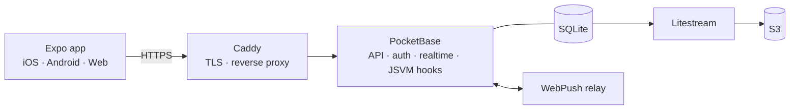

<div align="center">


<h1>Risev</h1>

<p><strong>Customer loyalty, run from the counter.</strong></p>

<p>
A multi-outlet loyalty and customer-engagement platform built for Malaysian merchants.
NFC tap-to-earn, digital stamp cards, vouchers, points, service bookings and outlet-level
analytics — in one app for iOS, Android and the web.
</p>

<br />

[](https://expo.dev)
[](https://reactnative.dev)
[](https://pocketbase.io)
[](https://www.typescriptlang.org)
[](#)

<br />

[Overview](#overview) · [Features](#features) · [Architecture](#architecture) · [Getting started](#getting-started) · [Project structure](#project-structure) · [Documentation](#documentation)

</div>

---

## Overview

Risev gives a merchant one place to reward the people who actually walk into their shop.

Customers join with a phone number, tap the stand on the counter (or scan a QR code), and
collect stamps and points that they can see and redeem straight from their phone. Merchants
get a POS-friendly issue screen, outlet management, campaigns, and reporting that answers both
*"how is the brand doing?"* and *"how is this outlet doing?"* from the same data.

The project is a single Expo codebase (native + web) talking to a self-hosted PocketBase
backend — no separate application server, no third-party loyalty platform.

## Features

<table>
<tr>
<td width="50%" valign="top">

**For customers**

- Digital stamp cards with animated progress
- Points wallet and reward catalogue
- Vouchers as boarding-pass tickets, redeemable by QR
- NFC tap-to-earn with live claim approval
- Merchant discovery by distance and category
- Booking history and visit timeline

</td>
<td width="50%" valign="top">

**For merchants**

- Point-of-sale stamp & points issuance (QR, phone, voucher code)
- Multi-outlet management with per-outlet reporting
- Loyalty programme, card design, points studio and milestones
- Campaigns, broadcasts and automated follow-ups
- Staff roles, permissions and performance
- Service catalogue and appointment bookings

</td>
</tr>
</table>

## Architecture



Everything runs on a single VPS behind Caddy. PocketBase owns the API, authentication, realtime
subscriptions and all server-side business logic — the domain rules live in JSVM hooks under
`pb_hooks/`, and the schema is versioned as auto-applied migrations under `pb_migrations/`.

| Layer | Technology |
| --- | --- |
| App | Expo SDK 56 · React Native 0.85 · React 19 · Expo Router |
| Language | TypeScript (strict) |
| Backend | PocketBase 0.39 (Go) — API, auth, realtime, JSVM hooks |
| Data | SQLite, continuously replicated to S3 by Litestream |
| Hosting | Vercel (web) · EAS (mobile) · Docker Compose on a single VPS |
| Testing | Playwright end-to-end specs |

## Getting started

**Prerequisites:** Node.js 20+, npm, and a PocketBase binary (or a reachable PocketBase instance).

```bash
# 1. Install dependencies
npm install

# 2. Configure the backend URL
cp .env.example .env
#    then set:  EXPO_PUBLIC_PB_URL=http://127.0.0.1:8090

# 3. Run the app
npm start          # Expo dev server — press w / i / a for web, iOS, Android
```

The app reads its backend URL from `EXPO_PUBLIC_PB_URL`; every other value in `.env.example`
(SMTP, S3, payment gateway, shipping, WebPush) is server-side configuration used by the
PocketBase hooks.

### Available scripts

| Script | What it does |
| --- | --- |
| `npm start` | Start the Expo dev server |
| `npm run web` | Start directly in the browser |
| `npm run build:web` | Static web export |
| `npm run build:production` | Production web build against `api.risev.app` |
| `npm run test:e2e` | Run the Playwright end-to-end suite |

## Project structure

```
app/                  Expo Router routes — (auth) · (customer) · (merchant) · public booking & NFC pages
components/           Shared UI (claim modal, branch form, receipts, notifications)
context/              AuthContext, LanguageContext (English + Bahasa Malaysia)
lib/                  PocketBase client and helpers
theme/                Design tokens, voucher spine themes, campaign recipes
pb_hooks/             PocketBase JSVM hooks — routes and server-side business logic
pb_migrations/        Versioned schema migrations (auto-applied on startup)
```

## Deployment

- **Web** — pushing to `main` deploys the web build to Vercel automatically.
- **Mobile** — built and shipped through EAS.
- **Backend** — Docker Compose on a single VPS (`Caddy`, `PocketBase`, `Litestream`,
  `Portainer`, and a WebPush relay). PocketBase applies pending migrations on startup;
  hook files hot-reload on change.

## Documentation

- [`AGENTS.md`](./AGENTS.md) — operational guide: architecture facts, deployment, and the
  pitfalls that are not obvious from the code.
- [`DESIGN_UI_UX_MEMORY.md`](./DESIGN_UI_UX_MEMORY.md) — the design system: colour rule of
  three, typography, the boarding-pass voucher system, and the rewards architecture.
- [`UI_UX_AGENTS.md`](./UI_UX_AGENTS.md) — the multi-agent UI/UX studio protocol.

## License

See [LICENSE](./LICENSE).

<div align="center">
<br />
<sub>Built for merchants in Malaysia.</sub>
</div>
